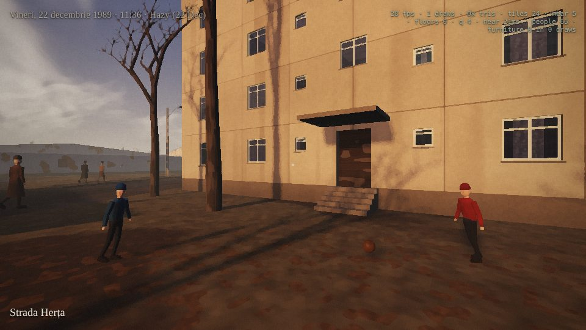
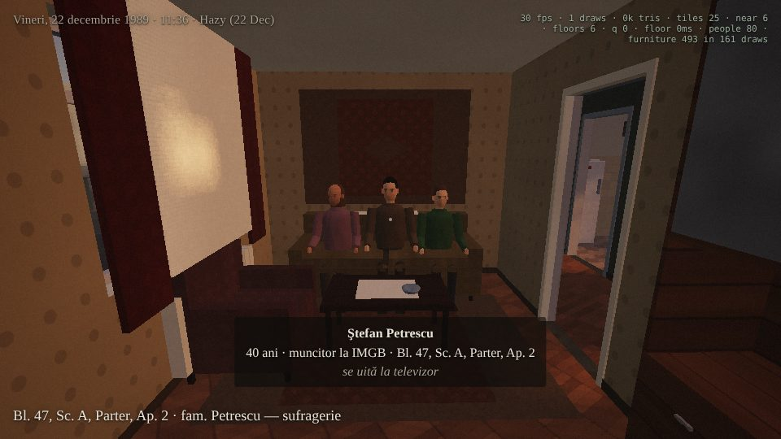
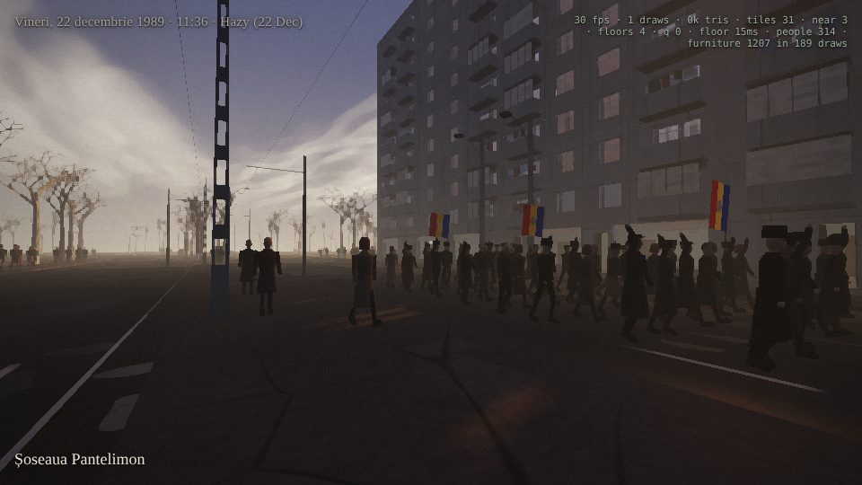
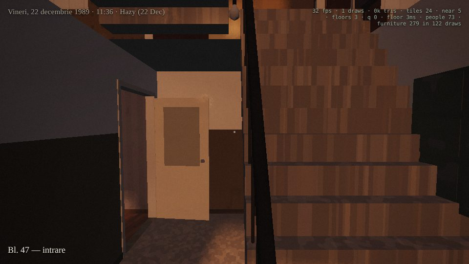
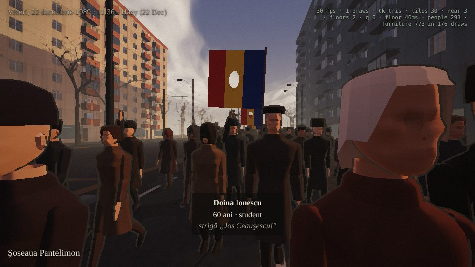
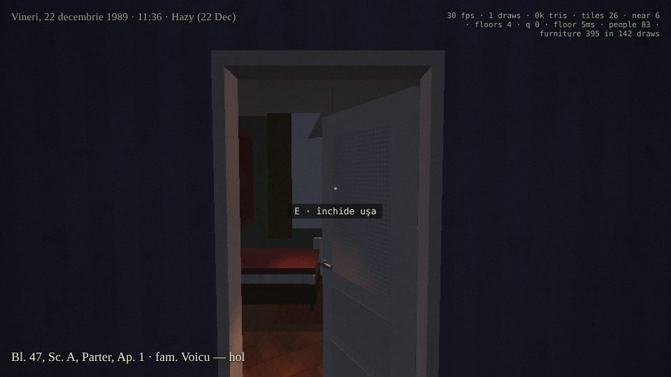

# Pantelimon, 1989: engine slice

This is a vertical slice of the engine for a longer game set during the Romanian Revolution. It sits next to the street demo in `../pantelimon-1989/`, keeps that demo's painterly look, and adds the systems a 2–3 hour game would need:

- **Real streets.** The ground plan of Pantelimon (about 1.3 × 1 km around Șoseaua Pantelimon) comes from OpenStreetMap and is adjusted to December 1989.
- **Every building can be entered.** Each one is generated with a floor plan, stairs, doors, windows, balconies and furnished rooms.
- **Every home has residents.** Households are posed where they would be that morning: on the sofa in front of the television, at the stove, at the window, in bed.
- **Streaming.** The city loads in tiles, nearby buildings are swapped for detailed versions, and their interiors load storey by storey, all built in a web worker.
- **A GPU crowd.** Residents, a column of marching workers, pedestrians and the street scene from the demo all share one instanced body that the vertex shader animates.
- **A portable format.** The generators are pure TypeScript with no three.js or DOM. They output plain JSON (see *Port format*), so another engine can load the same city, plans and people.

| | |
|---|---|
|  |  |
|  |  |
|  |  |

## Running it

```
npm install
npm run dev        # http://localhost:5173
npm run build      # typecheck + production build into dist/
npm run bake       # run every generator headless and check all rooms are reachable
```

WebGL 2 is required. Add `?debug` to the URL to see streaming and draw-call statistics, `?h=17.5` to start at another hour, and `?w=snow` (or `fog`, `overcast`) to change the weather.

| Input | Action |
|---|---|
| Mouse | Look (click to capture). Look at a person to see their name, age, job and what they're doing |
| `W` `A` `S` `D` | Walk; `Shift` to run; `Space` to jump |
| `T` / `G` | One hour later / earlier |
| `Y` | Weather: the haze of 22 December, overcast, the fog of the 21st, the first snow of the 26th |
| `P` | Paint filter on or off |
| `H` | The help card |

## The pipeline

```
OpenStreetMap ──tools/osm-fetch.mjs──▶ data/osm/pantelimon.osm
              ──tools/osm-1989.mjs───▶ public/data/city.json     (roads, tram lines, buildings, areas, trees)
                                            │
                            src/gen/*  (pure, deterministic, seeded by OSM id)
                                            │
     city.ts ── tiles, spatial index, street furniture per tile
     plan.ts ── footprint → wings → stair sections → flats → rooms, doors, windows, balconies, stairs
     furnish.ts ─ furniture per room, clear of doors and windows
     residents.ts ─ households, clothes, what each person is doing and where
                                            │
                            src/mesh/*  (pure, run in the worker)
                                            │
     building.ts ─ far shell · near exterior with real openings · per-storey interior · window plugs
     furniture.ts ─ 60 furniture models (instanced)     ground.ts ─ roads, setts, pavements, tram rails, catenary
     props.ts ─ trees, lamp posts, Dacias, benches      builder.ts ─ typed-array geometry builder
                                            │
                      src/worker.ts ⇄ src/world/stream.ts (main thread)
                                            │
     render/* ─ world shader, glass, sky, paint post, sun and weather
     crowd/*  ─ GPU-posed bodies, residents, the march, pedestrians
     world/collide.ts, walls.ts, player.ts ─ walls, floors, stairs, steps, kerbs
```

### Adjusting OpenStreetMap to 1989

`tools/osm-1989.mjs` projects the data to metres, with x east and z south, and removes what wasn't there in December 1989:
- buildings with a `start_date` of 1990 or later
- post-1989 brands (supermarkets, banks, petrol stations, phone shops)
- big-box retail, large offices and anything under construction

It also keeps a count of what it removed. Side streets without a surface tag become granite setts (*piatră cubică*). Building types are normalised to prefab block, house, school, workshop, church, garage, shop or service building, and storey counts come from `building:levels` or are inferred from the type and size. Entrance nodes are attached to their buildings, so the stair cores line up with the real doors.

### Building plans

`planBuilding()` takes about 2.5 ms per building, and its output depends only on the OSM id.

1. **Footprint.** The footprint's minimum-area oriented box gives the building's local frame. A raster largest-rectangle cover splits L, T and U shapes into wings.
2. **Prefab blocks.** Each wing is cut into stair sections at the real entrance nodes, or about every 17 m where there are none. A short wing gets one flat per floor with the stairs at the end.
3. **Stair cores.** Each core has a lobby, a straight ground flight, then switchback flights with half-landings and a stairwell window at every half-storey. The stairwell is open above the flights.
4. **Flats.** Each side of a core holds one flat per floor in three bands:
   - front: bath next to the core, kitchen, a small bedroom if there is room
   - middle: the hall, deep enough for a door off it
   - back: living room (with a balcony door) behind the core, then bedrooms

   Every room opens onto the hall, and the hall opens onto the landing.
5. **Other buildings.**
   - On blocks of 9 or more storeys facing a main road, the ground floor holds shops with a shopfront to the boulevard.
   - Houses have a hall with an internal flight.
   - Schools, workshops and offices have one room per half-storey off the landing.
   - Single-storey buildings are shops, garages (one door per bay), workshops or a church.
6. **Openings.** Every door and window is stored once on the room, with its side, span and sill and head heights. The facade and the interior are both cut from that one record.

`npm run bake` plans all 800 buildings, about 9,400 homes and other units, 49,000 rooms and 20,000 residents. It then checks with a graph search, through doors and up stairs, that **every room can be reached from the street** (0 unreachable at present), that no room is narrower than 0.8 m, and that no furniture sticks out of its room.

### Furniture and residents

Rooms are furnished according to their type and size. Items are placed along free stretches of wall, kept out of door swings, and tall pieces are kept away from windows. What a flat held in 1989:
- **Living room:** the wall unit with books and a vitrine, the sofa and armchairs, the television on its own little table with a doily, the valve radio, the woven *carpetă* on the wall, rugs.
- **Kitchen:** the white *aragaz* cooker, jars of winter preserves, an Arctic fridge, an oilcloth on the table.
- **Bathroom:** a bath with a washboard, a high cistern with a pull chain.
- **Hall:** a coat rack hung with winter coats and a fur hat, the rotary telephone, the wired radio speaker.
- **Every room:** a cast-iron radiator under each window, lace curtains with drapes.
- **Shops:** near-empty shelves with the one product stacked in pyramids.
- **Classrooms:** the pale rectangle where the Comrade's portrait hung until this morning.

Every home gets a household, apart from about 8% of flats, where the family has gone into town. A household is drawn from typical make-ups (couples, grandparents, children, lodgers). Each person has a Romanian name, an age, a job and indoor clothes, and an activity tied to a furniture "spot": watching TVR, listening to Radio Free Europe on the armchair, cooking, at the window, in bed, on the phone. Rooms with people in them are lit, and televisions are on in most occupied homes. Windows seen from the street show this too: lit rooms glow at dusk, and rooms with the television on flicker blue.

### Streaming and levels of detail

| Level | What | Radius | Built from |
|---|---|---|---|
| Tile (96 m) | ground, roads, pavements, tram rails, catenary; *far shells* of every building whose centre is in the tile (interior-mapped windows, balconies, roofs, aerials); street furniture | ~280 m | worker, one message per tile |
| Near building | the exterior with real openings, glass and reveals; one *plug* mesh per storey (interior-mapped panes) | 40 m (kept to 55 m) | worker |
| Storey | rooms, papered walls, floors, ceilings, stairs and landings; furniture and doors as instances; residents | the storey you're on ±1 inside; the 2–3 storeys at eye level from outside | worker |

A far shell is hidden on the GPU once its near version is up: every shell vertex carries its building's index (`aBid`), and a 1-byte-per-building texture (`uHide`) collapses those vertices. Storeys that aren't loaded show their plugs, so a facade never has holes. Furniture is drawn as one `InstancedMesh` per model, shared by every loaded storey, so a ten-storey block costs about 150 draw calls for furniture however many flats are in view.

### Rendering

All surfaces share one painterly uber-shader ported from the street demo. A per-vertex material code selects the surface:
- **Outside:** panel joints and mastic, plaster falling off to brick, granite setts, asphalt with patches and potholes, verges.
- **Inside:** parquet (strip or herringbone), terrazzo, ceramic tile, wallpapers, gloss oil-paint dados, carpets, lace, upholstery, the television screen.

Interior vertices are flagged, and their lighting changes to match: less sky light, the sun only through the windows, and a warm bulb in lit rooms after dark. Shadows come from a 2048² sun map that follows the camera. Lamp posts become point lights at night.

The post pass applies:
- a Kuwahara paint filter
- the muted East-bloc grade
- vignette, film weave and grain

The sun, moon and sky follow Bucharest's latitude on 22 December 1989, including the waning crescent moon.

### The crowd

The figures follow Nightfall Protocol's FigureKit (`games/nightfall-protocol/mockups/base-figure.html` on the Nightfall branches).
- **Bodies.** Every part is a loft of superellipse cross-sections taken from FigureKit's proportion tables for men and women: torso, pelvis, neck, arms, hands with a thumb, thighs, shins. Soft lobes give the chest and seat their shape.
- **Faces.** Heads are sculpted with FigureKit's displacement terms: eye sockets, brow ridge, cheekbones, the mouth's curve and both lips, chin, temples and the angle of the jaw. They have a faceted nose (bridge, tip and wings), ears, eyes and brows. Sockets, lips and cheeks are painted into the vertices.
- **Hair.** Hair is a block whose lower edge drops from the fringe to the ears to the nape, in a short crop, a longer cut and a bun.
- **Joints.** Elbows, wrists and knees get FigureKit's faceted joint blocks.
- **Ink.** People are drawn with FigureKit's ink: a back-facing shell pushed out in view space, so the stroke keeps its width on screen. It is wide enough to survive the paint filter. Light falls in three soft bands, FigureKit's inked toon eased into the painted street.

FigureKit builds one mesh per person, which a street of hundreds can't afford. Here the figure is split into one instanced mesh per body (man and woman) and one per face, twelve in all (six men, six women), with their hair. Each person is drawn twice, body and head, about 3,900 welded vertices in all. FigureKit's per-person build (`P.body`) becomes instance data the vertex shader applies before posing:
- girth
- shoulder width, which also carries the arms
- hips, which also carry the legs
- a belly under the coat
- age, with a stoop at the shoulders, the head pushed forward and soft knees

Builds and faces come from each person's name, so they stay the same from one visit to the next. The clothes of December 1989 are the lofts themselves, inflated for winter bulk:
- coats with a turned-up collar and a skirt to the knee
- trousers, or skirts with stockings
- winter shoes
- hats: flat cap, fur *căciulă*, knitted hat, *basma*

A flag on a pole and a rug for shaking out of a window are attachments.

The vertex shader computes forward kinematics from the instance's pose id and phase:
- walk cycle
- sitting
- lying in bed
- leaning out of a window
- cooking
- marching with a raised fist
- carrying a flag
- on the phone
- reading
- kicking a ball

Instance attributes carry position, pose, build, face and clothing colours, so the CPU only moves people along their paths. Everyone (residents, about 180 marchers, 70 pedestrians) is drawn in 14 instanced draws, plus 14 for the ink and 14 for the shadow map.

The march walks west along Șoseaua Pantelimon toward the centre, as the factory workers did on the morning of the 22nd. They chant "Jos Ceaușescu!" and "Ole, ole, ole, Ceaușescu nu mai e!", and some carry the tricolour with the arms cut out of it.

The street scene from the demo is staged in front of the block where you start:
- two boys passing a ball
- a woman shaking a rug out of a second-storey window
- a man walking past with *România Liberă* and a Carpați

### Doors

Every doorway on a loaded storey gets a door leaf, and every leaf is animated:
- **Interior doors** are cream panel doors with a frosted pane. They open into the room, never into the hall or the stairwell.
- **Flats' front doors** are padded brown leatherette with studs, a spy-hole and a brass number plate. They open into the flat's hall.
- **Block entrances** have double varnished doors with wired glass and a push bar.
- **Houses** have plank doors with a small window.
- **Shops** have glazed aluminium doors.
- **Workshops** have double steel doors.
- **Garages** have up-and-over steel doors that tilt up.

`world/doors.ts` derives them from the plan as pure data: hinge, width, height, the shut direction and the swing direction. A leaf hinges on whichever side keeps it clear of the stairs. `world/doorman.ts` animates them as instances on a springy hinge, with a little overshoot and a bump against the frame. A door opens as you come within about 1.5 m and swings shut a few seconds after you've gone. `E` opens or shuts the one you're facing, and a door you've shut stays shut until you leave. A shut door blocks you, and a swinging leaf is solid.

### Collision

`world/walls.ts` turns a plan into wall segments, each with a height range: room walls with their doorways cut out, facade bands open at entrances and balcony doors, balcony parapets, and the railing between switchback flights. It also produces walkable rectangles (floors with the stairwell cut out, landings, balcony slabs) and slopes (stair flights, entrance steps). The player is a capsule that walks up anything under 0.5 m, so stairs, kerbs and entrance steps are continuous. While a building's plan is still loading, its footprint is solid.

## Port format

Everything in `src/data/schema.ts` is plain JSON with no engine references. Units are metres, x points east, z south and y up. Angles are about +y, and the building-local frame is set by `plan.frame`. `npm run bake -- --out baked` writes:
- `baked/buildings/<id>.json`, one `BuildingPlan` per building, with every room, door, window, flight, landing, balcony, furniture item and resident
- `baked/tiles.json`, mapping each tile to its buildings and street props

To port:
1. Read `public/data/city.json` (or regenerate it from OSM).
2. Either run the TypeScript generators (`src/gen/*`, no dependencies) or load the baked JSON.
3. Build your own meshes from the plan records. `src/mesh/building.ts` shows how each record becomes geometry, and `src/world/walls.ts` how it becomes collision.

The furniture types are listed in `FURNITURE` (`src/gen/furnish.ts`) with their footprints. The front of each item faces +z at rotation 0.

## Not in this slice

These are the next steps toward the game:
- sound (the demo's procedural audio, crowd chants and gunfire)
- interaction with objects (drawers, the radio and TV dials, light switches)
- NPC schedules and pathfinding indoors
- the route into the centre (Piața Universității, the TV station, Palatul Telefoanelor)
- vehicles that move, including trams, ARO jeeps and TAB armoured carriers
- night combat lighting
- level-of-detail meshes for crowds above a few thousand people

The engine already scales to the whole city: building plans are lazy and deterministic, and only nearby storeys are ever built.

Map data © OpenStreetMap contributors, available under the Open Database License (ODbL).
